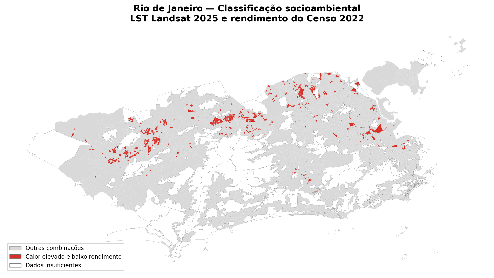
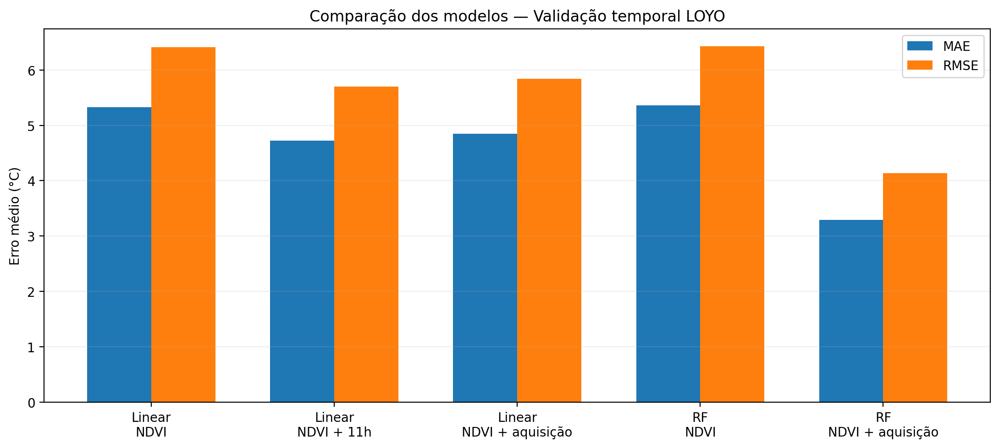
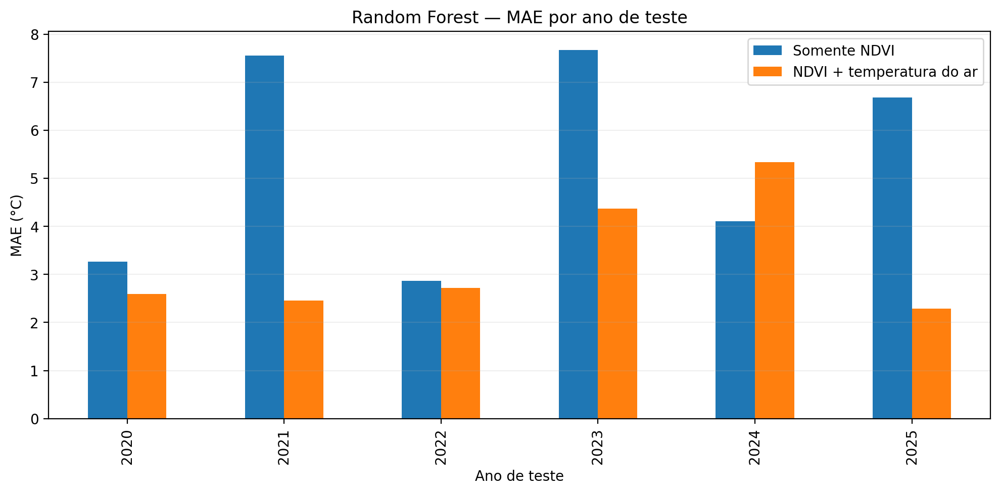

# Ilhas de Calor de Superfície no Município do Rio de Janeiro (2020–2025)

**Dashboard científico interativo para análise espacial e temporal da temperatura da superfície terrestre, modelagem por aprendizado de máquina e integração socioeconômica com dados do Censo Demográfico 2022.**

🌐 **[Acessar o dashboard](https://rio-suhi-dashboard.streamlit.app/)** · 💻 **[Repositório GitHub](https://github.com/Simone-Ingrid/rio-suhi-dashboard)**

> **Escopo:** seis cenas Landsat (uma por ano, 2020–2025) e uma análise socioambiental baseada na cena de 2025 e nos rendimentos do Censo 2022. As classificações e estimativas são exploratórias; não constituem previsão meteorológica nem índice validado de risco climático.

## 1. Visão geral

Este repositório documenta o produto computacional associado à pesquisa **“Modelo Computacional para Identificação e Predição de Ilhas de Calor Urbanas no Município do Rio de Janeiro utilizando Ciência de Dados e Geoprocessamento”**, proposta por **Simone Gama** em abril de 2026 ao Programa Pesquisa, Produtividade, Desenvolvimento Tecnológico e Extensão Inovadora (PPDTEI).

O dashboard, desenvolvido em Python e Streamlit, reúne imagens Landsat 8/9, indicadores espectrais, dados meteorológicos históricos e informações censitárias. Seu objetivo é apoiar a investigação exploratória da distribuição espacial da temperatura da superfície terrestre (*Land Surface Temperature*, **LST**), da relação entre LST e vegetação e da coincidência espacial entre calor superficial elevado e baixo rendimento.

### Destaques da versão atual

| Componente | Resultado ou funcionalidade |
|---|---|
| Recorte temporal | 2020–2025, com **uma cena Landsat por ano** |
| Mapas e indicadores | LST e NDVI, estatísticas e comparações entre cenas |
| Modelagem espacial de 2025 | Random Forest: **MAE 2,2152 °C; R² 0,7328** na avaliação espacial |
| Validação temporal multianual | Random Forest com NDVI + temperatura do ar: **MAE médio 3,2949 °C** (LOYO) |
| Integração com o IBGE | **13.782 setores** censitários do município |
| Classificação socioambiental | **770 setores** com calor superficial elevado e baixo rendimento (**6,03% dos elegíveis**) |
| Exploração cartográfica | Mapa estático e **mapa interativo por setor**, com indicadores em tooltip |



*Figura 1 — Classificação exploratória dos setores censitários a partir da LST da cena Landsat de 2025 e do rendimento mediano do Censo 2022. Vermelho: calor elevado e baixo rendimento; cinza: outras combinações; branco: dados insuficientes.*

## 2. Objetivos e funcionalidades

O projeto busca organizar dados de sensoriamento remoto, investigar padrões térmicos e de vegetação, oferecer visualizações geoespaciais e avaliar modelos estatísticos de estimativa de LST. A versão publicada disponibiliza:

- Seleção das cenas de **2020 a 2025**, estatísticas anuais de LST e NDVI e gráficos comparativos.
- Mapas interativos de LST e comparação espacial entre anos.
- Modelagem espacial de **2025** com Regressão Linear e Random Forest; estimativa interativa de LST a partir do NDVI com o modelo treinado para essa cena.
- Comparação de modelos multianuais com validação **Leave-One-Year-Out (LOYO)** e integração experimental da temperatura do ar.
- Análise socioambiental com indicadores de rendimento do IBGE, mapa estático e mapa interativo por setor censitário, incluindo código do setor, LST média, rendimento mediano, número de pixels válidos e classe.

A ferramenta interativa de estimativa de LST para 2025 **não prevê a temperatura do ar ou a LST de datas futuras**. Os resultados LOYO são apresentados como avaliação experimental, sem um modelo multianual de previsão futura publicado.

## 3. Fontes e características dos dados

| Fonte | Dados e utilização |
|---|---|
| **Landsat 8/9 — Collection 2, Level-2** | Bandas térmicas e de reflectância para LST e NDVI; seis cenas de verão entre 2020 e 2025 |
| **ERA5-Land**, consultado por meio de dados históricos | Temperatura do ar de referência para as datas e horários aproximados de aquisição |
| **IBGE — Censo Demográfico 2022** | Agregados por setores censitários relativos ao rendimento das pessoas responsáveis pelos domicílios |
| **IBGE — Malha de Setores Censitários 2022** | Polígonos e identificadores geográficos para associação espacial |

A área de estudo é o **município do Rio de Janeiro (RJ), Brasil**. Os rasters processados de LST possuem resolução nominal de **30 m** e utilizam **EPSG:32623** (WGS 84 / UTM zona 23S). A malha censitária foi lida em **EPSG:4674** (SIRGAS 2000) e reprojetada para o sistema do raster durante a integração espacial.

As seis aquisições ocorreram aproximadamente às **12h52 UTC (09h52 em Brasília)**:

| Ano | Satélite | Data da cena |
|---|---|---|
| 2020 | Landsat 8 | 26/01/2020 |
| 2021 | Landsat 8 | 28/01/2021 |
| 2022 | Landsat 8 | 16/02/2022 |
| 2023 | Landsat 9 | 27/02/2023 |
| 2024 | Landsat 9 | 29/01/2024 |
| 2025 | Landsat 9 | 16/02/2025 |

O **NDBI** foi considerado no processamento original, mas sua consistência multianual ainda requer validação; por isso, não é utilizado como variável explicativa nos resultados de modelagem aqui apresentados.

## 4. Processamento geoespacial

O processamento principal foi realizado no **QGIS**, com etapas complementares em **Python/Google Colab**:

1. Aquisição, organização e recorte das cenas Landsat para o município.
2. Aplicação das máscaras de qualidade e tratamento de pixels inválidos/NoData.
3. Conversão da banda `ST_B10` para LST em °C, usando fatores de escala e deslocamento do produto Landsat Collection 2 Level-2.
4. Cálculo do NDVI a partir das bandas de reflectância do vermelho e do infravermelho próximo.
5. Extração de estatísticas e preparação de amostras de pixels para modelagem.
6. Avaliação espacial dos modelos para 2025 e avaliação temporal entre as seis cenas.
7. Integração dos indicadores censitários à malha e cálculo da LST média por setor em 2025.

As análises de LST referem-se à **temperatura radiométrica da superfície**, não à temperatura do ar nem à exposição térmica pessoal.

## 5. Modelagem espacial — cena de 2025

Foram avaliados modelos de **Regressão Linear** e **Random Forest Regressor** para estimar LST a partir de NDVI, com **100.000 pixels amostrados** da cena de 2025. A avaliação utilizou separação espacial por blocos para reduzir a proximidade direta entre amostras de treinamento e teste.

| Modelo | MAE (°C) | RMSE (°C) | R² |
|---|---:|---:|---:|
| Regressão Linear | 2,4326 | 3,1454 | 0,6843 |
| **Random Forest** | **2,2152** | **2,8937** | **0,7328** |

O Random Forest obteve o melhor resultado nesse experimento espacial. **Isso não demonstra capacidade de generalização para outros anos**, que foi avaliada separadamente.

## 6. Modelagem multianual e validação temporal

A base experimental contém **600.000 observações de pixels**, sendo **100.000 por cena/ano**. Foram comparados modelos baseados em NDVI e modelos que também utilizam temperatura do ar. A temperatura na passagem do satélite foi estimada por interpolação temporal de registros meteorológicos horários.

Na validação **Leave-One-Year-Out (LOYO)**, cada uma das seis cenas foi reservada para teste em uma rodada, enquanto as cinco restantes foram utilizadas para treinamento. As métricas abaixo são **médias aritméticas das métricas anuais**; em particular, o R² informado é a **média dos seis R² anuais**, e não um R² calculado sobre todas as previsões agrupadas.

| Algoritmo | Variáveis | MAE médio (°C) | RMSE médio (°C) | R² médio anual |
|---|---|---:|---:|---:|
| Regressão Linear | NDVI | 5,3281 | 6,4099 | −0,4507 |
| Regressão Linear | NDVI + temperatura às 11h | 4,7220 | 5,6955 | −0,2394 |
| Regressão Linear | NDVI + temperatura na aquisição | 4,8479 | 5,8392 | −0,2603 |
| Random Forest | NDVI | 5,3573 | 6,4231 | −0,4558 |
| **Random Forest** | **NDVI + temperatura na aquisição** | **3,2949** | **4,1389** | **0,3887** |

A inclusão da temperatura do ar no Random Forest reduziu o MAE médio em aproximadamente **38,5%** em relação ao Random Forest com NDVI isolado. Houve melhoria em **cinco dos seis anos**, com piora em **2024**.



*Figura 2 — MAE e RMSE médios na validação LOYO.*



*Figura 3 — MAE anual do Random Forest com e sem temperatura do ar.*

Apesar da grande quantidade de pixels, o experimento contém apenas **seis situações meteorológicas de aquisição**. Portanto, o desempenho é exploratório e não constitui validação suficiente para previsão confiável em anos futuros.

## 7. Integração socioeconômica — LST 2025 e Censo 2022

### 7.1. Associação das bases

Foi utilizada a variável censitária **`V06006`**, referente ao **valor do rendimento nominal mediano mensal das pessoas responsáveis com rendimento**, por setor censitário. Os registros de rendimento foram associados à malha geográfica do IBGE por meio do identificador **`CD_SETOR`**.

A malha do município contém **13.782 setores**, dos quais **13.474** apresentaram correspondência na base de rendimento. Os **308 setores** sem registro econômico foram mantidos, sem imputação de renda zero. Considerando também valores ausentes no indicador, **13.368 setores** apresentaram rendimento mediano válido.

### 7.2. Cálculo de LST por setor

As geometrias foram reprojetadas para **EPSG:32623** e cruzadas com o raster de LST de **16/02/2025**. Para cada setor, foi calculada a média dos pixels válidos incluídos pelo procedimento de mascaramento/rasterização (`all_touched=False`), além da contagem de pixels válidos.

A LST média foi obtida para **13.770 setores**. Entre eles, **13.359** também possuíam rendimento mediano válido. Para a classificação principal, foi adotado o critério operacional de **pelo menos cinco pixels válidos**, resultando em **12.760 setores elegíveis**.

### 7.3. Critérios da classificação

Os limiares foram calculados **exclusivamente entre os setores elegíveis**:

| Critério | Regra |
|---|---|
| **Calor elevado** | LST média **≥ 48,27 °C** (percentil 75) |
| **Baixo rendimento** | Rendimento mediano **≤ R$ 1.290,75** (percentil 25) |
| **Calor elevado e baixo rendimento** | Satisfaz simultaneamente os dois critérios |
| **Outras combinações** | Setor elegível que não satisfaz ambos os critérios |
| **Dados insuficientes** | Setor não elegível, por ausência de dados válidos ou menos de cinco pixels válidos |

Essa classificação é uma **identificação exploratória de coincidência espacial** entre condições térmicas e econômicas; não é um índice validado de vulnerabilidade, exposição humana ou risco à saúde.

### 7.4. Resultados da classificação

| Indicador | Resultado |
|---|---:|
| Setores censitários do município | 13.782 |
| Com LST válida | 13.770 |
| Com rendimento mediano válido | 13.368 |
| Com ambas as variáveis válidas | 13.359 |
| Elegíveis para classificação | **12.760** |
| **Calor elevado e baixo rendimento** | **770** |
| Outras combinações | 11.990 |
| Dados insuficientes | 1.022 |
| Percentual prioritário entre os elegíveis | **6,03%** |

Na análise descritiva dos **13.359 setores com ambas as variáveis válidas**, sem exigir o mínimo de cinco pixels, a associação entre LST média e rendimento mediano foi:

- **Correlação de Pearson:** −0,4915.
- **Correlação de Spearman:** −0,2817.

Os coeficientes indicam associação negativa, de intensidade diferente conforme a medida utilizada. **Não permitem inferência causal**, e a interpretação depende da escala setorial e da heterogeneidade espacial.

### 7.5. Mapas e consulta interativa

O dashboard apresenta um **mapa estático** da classificação e um **mapa interativo** em que o usuário pode navegar pelos setores e visualizar, ao passar o cursor, o código censitário, a classe, a LST média (°C), o rendimento mediano (R$) e a quantidade de pixels válidos.

A visualização interativa utiliza `data/setores_rio_socioambiental_2025.geojson.gz`, com geometrias simplificadas para reduzir o volume de dados transferido. Os cálculos científicos foram realizados com a malha original, antes dessa simplificação.

## 8. Principais achados e interpretação

Os experimentos documentam: (i) associação negativa entre NDVI e LST nas seis cenas; (ii) melhor desempenho espacial do Random Forest em 2025; (iii) limitações importantes dos modelos que utilizam apenas NDVI na generalização temporal; (iv) melhora média do Random Forest multianual quando se inclui temperatura do ar; e (v) coincidência espacial de calor superficial relativamente elevado e baixo rendimento em **770 setores censitários** da cena analisada.

Esses achados descrevem **padrões observados nas cenas e nos dados censitários utilizados**, sem estabelecer tendências climáticas de longo prazo, causalidade ou vulnerabilidade individual.

## 9. Tecnologias

| Tecnologia | Aplicação |
|---|---|
| Python, NumPy, Pandas | Tratamento, organização e análise dos dados |
| QGIS, Rasterio, GeoPandas | Processamento raster e vetorial; integração espacial |
| Scikit-learn, Joblib | Modelagem e serialização do modelo espacial de 2025 |
| Matplotlib, Plotly | Gráficos científicos e visualizações |
| Folium, Streamlit-Folium | Mapas interativos e consulta aos setores |
| Streamlit | Interface do dashboard |
| Google Colab e Google Drive | Experimentação e armazenamento dos dados de trabalho |
| GitHub | Versionamento e publicação do código e dos resultados |

## 10. Organização do repositório

```text
rio-suhi-dashboard/
├── app/
│   └── app.py
├── assets/
│   ├── comparacao_modelos_multianuais.png
│   ├── random_forest_mae_por_ano.png
│   └── mapa_socioambiental_rio_2025.png
├── data/
│   ├── rasters/
│   │   └── LST_2020_RIO.tif ... LST_2025_RIO.tif
│   ├── estatisticas_SUHI_2020_2025.csv
│   ├── comparacao_modelos_multianuais.csv
│   ├── resultados_rf_multianual_loyo.csv
│   ├── resumo_meteorologico_2020_2025.csv
│   ├── temperatura_ar_aquisicao_2020_2025.csv
│   ├── datas_cenas_landsat.csv
│   └── setores_rio_socioambiental_2025.geojson.gz
├── docs/
├── models/
│   └── random_forest_lst_2025_compactado.joblib
├── notebooks/
├── requirements.txt
└── README.md
```

Os arquivos de trabalho completos do IBGE e os GeoPackages analíticos são mantidos separadamente no ambiente de pesquisa; o repositório publica a versão geográfica simplificada para visualização.

## 11. Execução local

É necessário ter Python instalado. A partir da raiz do repositório:

```bash
git clone https://github.com/Simone-Ingrid/rio-suhi-dashboard.git
cd rio-suhi-dashboard
python -m pip install -r requirements.txt
streamlit run app/app.py
```

A execução depende da presença dos arquivos de dados e do modelo indicados na estrutura acima. Para consultar a versão publicada, utilize **https://rio-suhi-dashboard.streamlit.app/**.

## 12. Limitações metodológicas

1. **Amostragem temporal:** apenas uma cena por ano (2020–2025), obtida em dias e condições meteorológicas diferentes. Comparações entre cenas não representam, por si, uma tendência climática.
2. **LST versus temperatura do ar:** a temperatura da superfície não equivale à temperatura do ar, ao conforto térmico ou à exposição individual.
3. **Generalização temporal:** os 600.000 pixels derivam de apenas seis cenas e seis condições meteorológicas; a validação LOYO não comprova previsibilidade em anos futuros.
4. **Representação meteorológica:** a temperatura do ar utilizada é uma referência de reanálise para a região, não uma medição independente em cada pixel.
5. **Índices espectrais:** a consistência do NDBI multianual ainda requer validação adicional.
6. **Defasagem entre fontes:** a LST socioambiental é de 2025 e o rendimento censitário é de 2022.
7. **Cobertura por setor:** o mínimo de cinco pixels válidos é um limiar operacional e não assegura cobertura integral nem igual precisão entre setores.
8. **Classificação relativa:** os percentis P75 e P25 dependem da distribuição dos setores elegíveis; não são limites universais de risco.
9. **Interpretação socioeconômica:** o rendimento mediano das pessoas responsáveis com rendimento não representa diretamente a renda domiciliar per capita nem todos os componentes de vulnerabilidade social.
10. **Dependência espacial e causalidade:** setores vizinhos podem apresentar dependência espacial; correlações descritivas não demonstram causalidade.
11. **Visualização simplificada:** as geometrias do GeoJSON interativo foram simplificadas para exibição e podem diferir ligeiramente da malha original.

## 13. Situação do projeto e continuidade

| Objetivo | Situação na versão atual |
|---|---|
| Processamento e organização das cenas Landsat | Implementado |
| Exploração de LST e NDVI e mapas interativos | Implementado |
| Dashboard científico público | Implementado |
| Modelagem espacial de LST | Implementado para a cena de 2025 |
| Comparação de modelos e validação temporal LOYO | Experimentos exploratórios concluídos |
| Integração experimental de temperatura do ar | Implementada |
| **Integração socioeconômica com Censo 2022** | **Implementada** |
| **Mapa estático e mapa interativo por setor censitário** | **Implementados** |
| Indicador composto e validado de vulnerabilidade climática | Trabalho futuro |
| Validação com mais cenas, anos e condições ambientais | Trabalho futuro |
| Validação adicional do NDBI | Trabalho futuro |

A **primeira versão funcional do produto está concluída e publicada**. Entre as possibilidades de continuidade científica estão a ampliação da amostragem temporal, a inclusão de novas variáveis ambientais e sociais, a avaliação de autocorrelação espacial e a construção/validação de um indicador mais abrangente de vulnerabilidade climática.

## 14. Considerações finais

O projeto resultou em um **dashboard científico público e funcional** que combina sensoriamento remoto, geoprocessamento, análise estatística, aprendizado de máquina e indicadores socioeconômicos. A aplicação oferece resultados quantitativos, mapas exploratórios e consulta interativa por setor censitário, acompanhados das limitações necessárias à interpretação científica.

---

**Projeto de pesquisa:** Modelo Computacional para Identificação e Predição de Ilhas de Calor Urbanas no Município do Rio de Janeiro utilizando Ciência de Dados e Geoprocessamento.  
**Autoria:** Simone Gama.  
**Proposta original:** Abril de 2026.  
**Período das cenas Landsat:** 2020–2025.  
**Produto:** Dashboard científico interativo de Ilhas de Calor de Superfície.  
**Estado atual:** Primeira versão funcional publicada, com modelagem espacial, avaliação temporal exploratória e integração socioeconômica.
